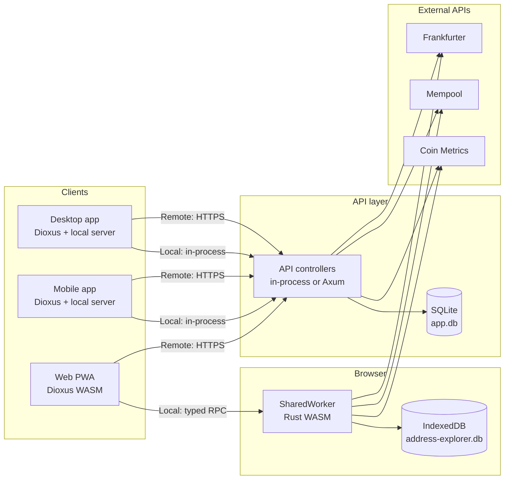
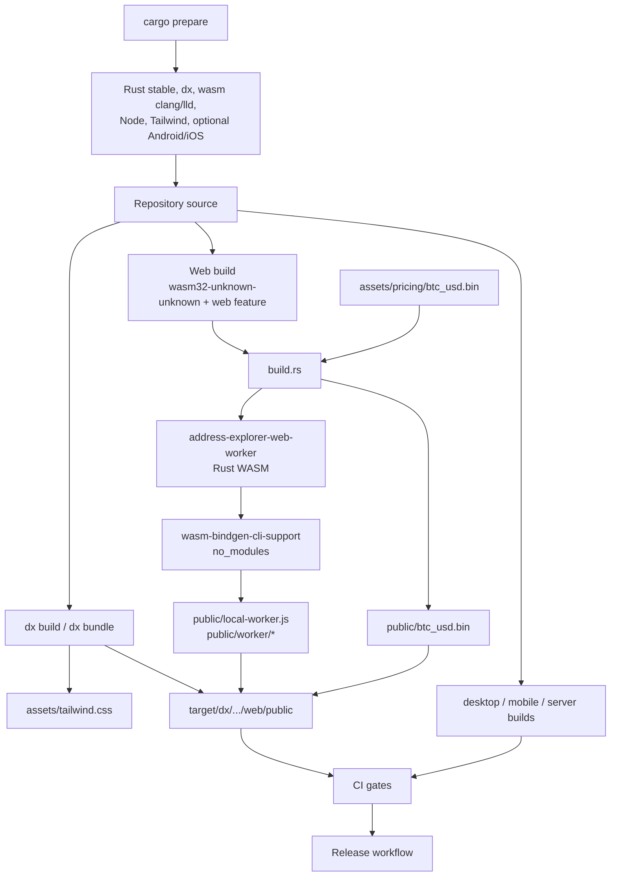
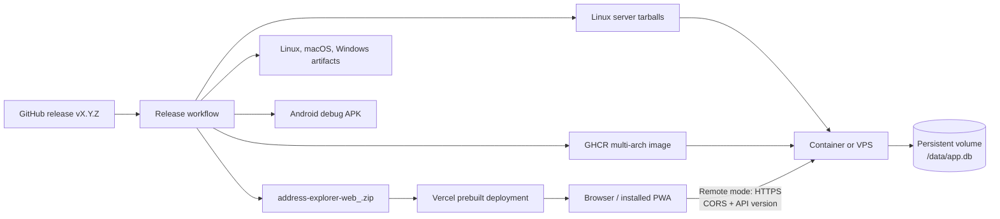
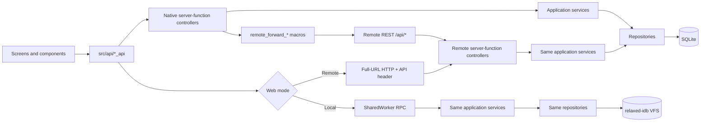
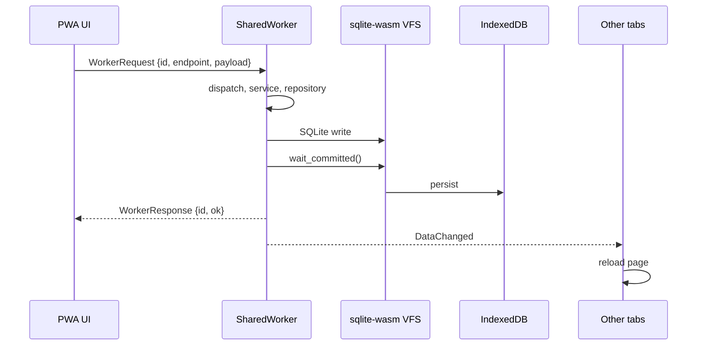
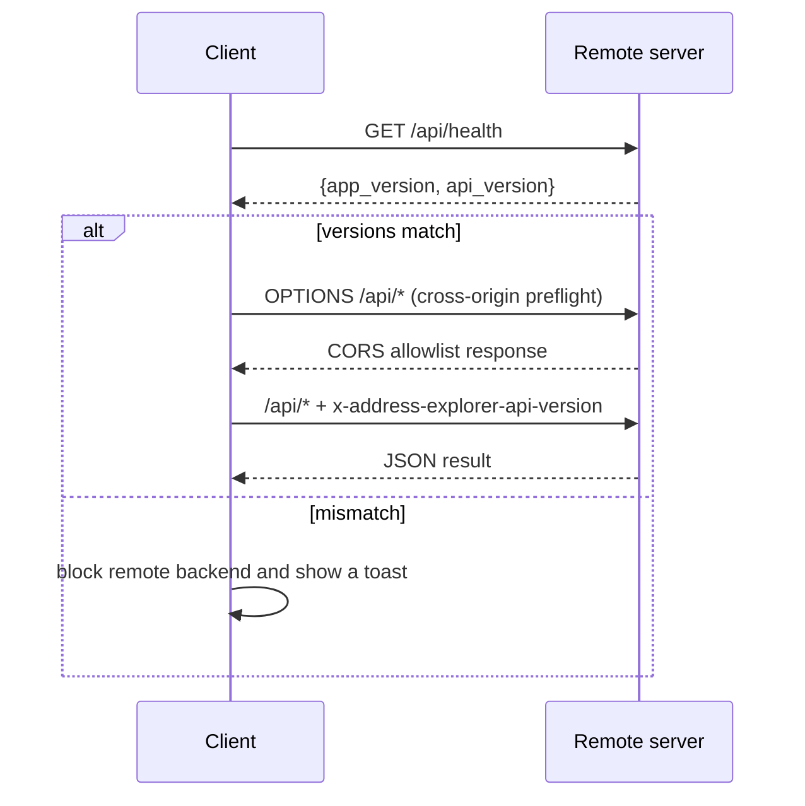
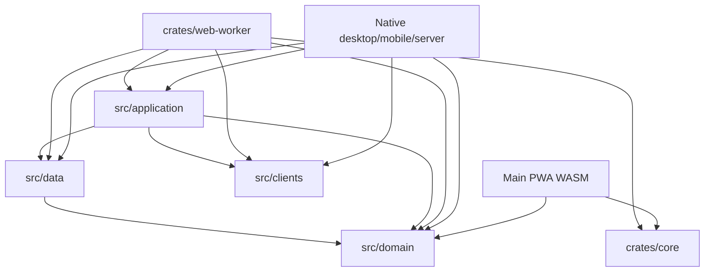

# Architecture

This page explains how Address Explorer is assembled, built, deployed, and how
its clients communicate with their backends. It is an explanatory overview:
the normative rules live in [`CONTRIBUTING.md`](../CONTRIBUTING.md), the
toolchain and command matrix lives in [`BUILDING.md`](BUILDING.md), and
server/PWA operations live in [`deployment.md`](deployment.md).

## 1. System at a glance

Address Explorer is one Dioxus user interface with two runtime backends:

- **Local** — the bundled SQLite database. Native builds run the API
  controllers in process; the web PWA runs them in a SharedWorker and stores
  the database in IndexedDB.
- **Remote** — a separate Address Explorer server build reached over
  HTTP(S). The server owns its own SQLite database and applies the API version
  guard and the CORS allowlist.

The first-run default is Local. The two databases are separate; switching
backends reloads the application and never migrates data automatically.

### Runtime modes

| Mode | UI | Transport | Data store |
| --- | --- | --- | --- |
| Native Local | Desktop or mobile | In-process API controllers | Local SQLite file |
| Native Remote | Desktop or mobile | HTTP REST + API version header | Remote server SQLite |
| Web Local | Browser PWA | SharedWorker RPC | Browser SQLite through relaxed-idb |
| Web Remote | Browser PWA | Full-URL HTTP + API version header | Remote server SQLite |
| Pure server | No interactive UI | Axum REST | Server SQLite |

The pure server build forces `BackendMode::Local` and cannot forward to
another server. Native builds are always all-in-one: `desktop` and `mobile`
include the local server and the optional remote backend.

## 2. Build architecture

### Toolchain preparation

`cargo prepare` installs the Rust stable toolchain, Dioxus CLI, wasm clang and
lld, Node/Tailwind, and the platform build dependencies. `cargo prepare --all`
also installs the Android toolchain and, on macOS, verifies Xcode and the iOS
targets. CI uses the composite action in
[`.github/actions/prepare/action.yml`](../.github/actions/prepare/action.yml),
which calls `cargo prepare --github-env` so detected paths are exported to
later steps.

See [`BUILDING.md`](BUILDING.md) for the exact host matrix, version pins, and
troubleshooting.

### Web build pipeline

A web build is self-contained because the root `build.rs` owns the
SharedWorker build:

1. `build.rs` runs only for a `wasm32` target with the `web` feature.
2. It builds `address-explorer-web-worker` in release mode with a separate
   `CARGO_TARGET_DIR`.
3. It converts the worker WASM with `wasm-bindgen-cli-support` in
   `no_modules` mode. No external `wasm-bindgen-cli` is required.
4. It writes `public/local-worker.js`, `public/worker/*`, and
   `public/btc_usd.bin`.
5. The Dioxus CLI builds the main PWA and regenerates `assets/tailwind.css`
   from `tailwind.css` with the pinned Tailwind 4.1.5 binary.

Native desktop/mobile and pure-server builds do not build the worker and do
not require wasm clang. The pure server selects only the `server` feature;
`desktop` and `mobile` already include `server` and `remote-backend`.

### Generated and committed artifacts

| Path | Status | Produced by |
| --- | --- | --- |
| `assets/pricing/btc_usd.bin` | committed | `cargo run --bin pricing_pack` |
| `assets/tailwind.css` | committed | Dioxus CLI + Tailwind |
| `public/local-worker.js` | generated, gitignored | `build.rs` |
| `public/worker/*` | generated, gitignored | `build.rs` + `wasm-bindgen-cli-support` |
| `public/btc_usd.bin` | generated, gitignored | `build.rs` copy |
| `assets/pricing/raw_data/` | ignored | Kaggle exports |

### CI and release

CI runs formatting, `dx check` for web/desktop/fullstack, native tests,
Clippy for server/desktop/web/worker, and a release web build that fails when
the committed Tailwind stylesheet differs. CI runs on Linux.

The release workflow validates the tag against `Cargo.toml`, the `main`
branch, and a successful CI run before it builds the web PWA, desktop
artifacts, Android APK, server tarballs, and the multi-arch GHCR image. It then
publishes checksums and deploys the prebuilt PWA to Vercel. See
[`release.md`](release.md).

## 3. Deployment architecture

### PWA static hosting

The deployable directory is
`target/dx/address-explorer/release/web/public`. It must be served over HTTPS
(or `localhost`) for the service worker and must rewrite unknown application
paths to `index.html` for the client-side router. API paths are different:
`/api/*` must return 404 on the static host rather than the SPA shell, because
the remote server is a separate origin.

Vercel deployment uses `scripts/build-vercel-output.sh`, which creates a
Vercel Build Output tree with:

- no-cache revalidation for `index.html`, `sw.js`, `sw-register.js`,
  `local-worker.js`, `/worker/*`, `btc_usd.bin`, and the manifest;
- immutable one-year caching for hashed `/assets/*`;
- a 404 for `/api/*`;
- filesystem handling followed by the `index.html` fallback.

`vercel.json` disables the Vercel Git integration so a source push does not
create a second deployment. The release workflow deploys the prebuilt output.

### Optional remote server

The server tarball contains the native binary, `assets/pricing/btc_usd.bin`,
an empty-but-required `public/` directory, `LICENSE`, and `README.md`. The
runtime image copies the prebuilt binary and seed into a Debian slim image,
runs as UID 10001, stores `/data/app.db`, and exposes `/api/health` as its
healthcheck. The root `Dockerfile` is a separate source-build alternative; the
release workflow uses `.github/docker/server-runtime.Dockerfile`.

See [`deployment.md`](deployment.md) for run commands, environment variables,
CORS, volume ownership, security, and backups.

## 4. Client-server communication

All screens call the same public `*_api` functions. The transport is selected
at build time and runtime, not in the screen:

- native Local: server-function bodies execute in process;
- native Remote: server-function bodies forward through the remote helper;
- web Local: wrappers call the SharedWorker RPC;
- web Remote: wrappers call the remote server with a full base URL.

The API controllers stay thin: they open the active database, call one
application service operation, and translate errors. The worker dispatcher and
the native forwarding macros are transport adapters; business rules and SQL
stay in the application and data layers.

### Web Local write sequence

The writing tab keeps its own reactive resources and refetches after its
request succeeds. Other tabs receive the `DataChanged` broadcast and reload so
they cannot keep stale rows. The worker awaits the patched commit barrier
before reporting a write as successful.

### Remote version and CORS sequence

`/api/health` is exempt from the version guard. Every other remote `/api/*`
request must carry `x-address-explorer-api-version`; the pure server returns
HTTP 426 with a structured error when it is missing or mismatched. CORS is the
outermost layer so error responses carry the headers the browser needs, and
OPTIONS preflight is answered before the version guard. There is no
permissive `*` default: `ADDRESS_EXPLORER_CORS_ORIGINS` is an explicit
allowlist.

## 5. Shared code and boundaries

The `data`, `application`, `clients`, and `domain` modules stay in `src/` as
the shared backend source. `crates/web-worker` includes those files directly
with `#[path]`, so the worker has the same schema, migrations, seeds,
repositories, services, and external clients as native builds. The main PWA
WASM must not link `rusqlite`, SQLite C, the application layer, the data layer,
or the external API clients. `crates/core` owns the worker envelope and
protocol version.

## 6. Version contracts

| Contract | Current value | Source of truth | Bump when |
| --- | --- | --- | --- |
| Database schema | `22` | `src/data/migrations.rs` | A new migration is appended |
| API contract | `2` | `src/domain/health.rs` | An endpoint path or request/response shape changes incompatibly |
| Worker protocol | `2` | `crates/core/src/lib.rs` | An RPC request/response variant or payload shape changes |
| Application version | Package version | `Cargo.toml` | A release is published |
| Service-worker cache | `address-explorer-v1` | `public/sw.js` | The stable precache list or caching semantics change |

The database schema, API, and worker protocol are independent version axes.
Do not reuse one to imply compatibility with another.

## 7. Data lifecycle

Native builds store SQLite at `<workspace>/target/db/app.db` in debug builds
and in the platform application-data directory in release builds, with the
legacy `~/address-explorer/app.db` path honored when it already exists.
`DATABASE_PATH` overrides both. Browser Local uses the fixed virtual filename
`address-explorer.db` through the relaxed-idb VFS; it is not a filesystem file.

Native seed migrations import `assets/pricing/btc_usd.bin` and the researched
address catalog. The browser worker fetches `/btc_usd.bin` and imports it when
the database is new or its `user_version` is below the price-seed migration.
The same migration list and `CURRENT_SCHEMA_VERSION` are used on every target.

An optional encryption vault protects the database at rest. Native and server
builds use SQLCipher; the browser worker uses SQLite3MC's SQLCipher-compatible
codec. Argon2id derives a 256-bit raw key from the password, and the public
16-byte salt is the SQLCipher header salt. The key is kept in zeroizing memory
only while unlocked and is discarded after the configured idle timeout or an
explicit lock. The password itself is never stored. See
[`ENCRYPTION.md`](ENCRYPTION.md).

Export produces an ordinary plaintext SQLite snapshot, including from an
encrypted database. Native/server import checks the SQLite header, validates
the candidate, migrates it, and writes it into the active database. Browser
import decodes the base64 file, validates `PRAGMA integrity_check`,
`user_version > 0`, the `setting` table, the migration chain, the current
schema, and foreign keys, then writes it into the active database. A rejected
import restores the previous database. There is no backup file-size limit; the
export dialog limits only the normalized file name.

See [`CONTRIBUTING.md`](../CONTRIBUTING.md) for the normative backup, migration,
and commit-barrier rules.

## 8. Where to read more

- [`CONTRIBUTING.md`](../CONTRIBUTING.md) — code rules, architecture layers,
  SQLite conventions, tests, and review checklist.
- [`BUILDING.md`](BUILDING.md) — toolchain, commands, bundle matrix, and
  troubleshooting.
- [`deployment.md`](deployment.md) — PWA hosting, server tarball/container,
  environment, CORS, security, and backups.
- [`ENCRYPTION.md`](ENCRYPTION.md) — database encryption, key handling, idle
  locking, and recovery limits.
- [`release.md`](release.md) — release validation, artifacts, Vercel, and
  changelog.
- [`installation.md`](installation.md) — end-user installation notes.
